# nn-learning-by-doing

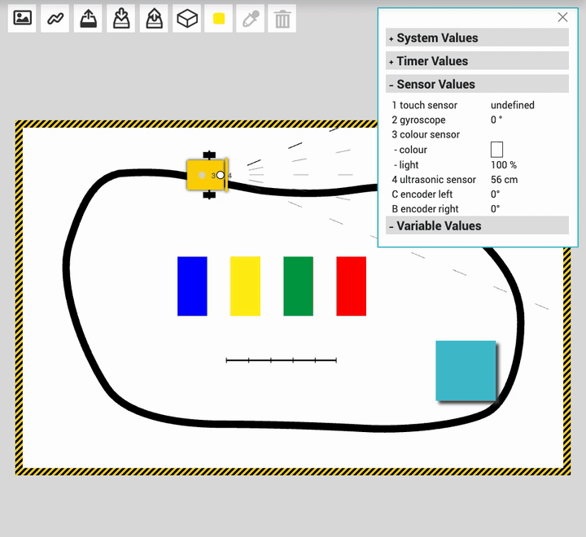

Four small neural network projects, each small enough to compute by hand and each documented with screenshots, animations and the numbers behind them. From a single weight that doubles a value, to a hidden ReLU layer that steers a robot, to a matchbox learner and a Deep Q-Network.

These are exercises from the Machine Learning module of the M.Eng. Digital Engineering and Consulting at HS Albstadt-Sigmaringen.

## Projects

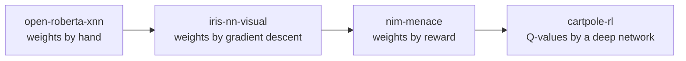

| Project | Network | What it shows | Tool |
|---|---|---|---|
| [open-roberta-xnn](open-roberta-xnn) | 1-1, 2-1, 2-3-2 ReLU | Weights and biases set by hand, then trained, drive a simulated robot | [Open Roberta Lab](https://lab.open-roberta.org/) |
| [iris-nn-visual](iris-nn-visual) | 4-4-4-3 ReLU + softmax | Forward pass, gradients and weight updates, three learning rates | [nn-visual](https://www.nn-visual.com/) |
| [nim-menace](nim-menace) | boxes with chips | Reinforcement learning without a programmed strategy, in Python | own code |
| [cartpole-rl](cartpole-rl) | DQN 4-32-32-2 | Exploration, replay memory, target network | [ML HIVE](https://mlhive.com/playground/machine-learning/reinforcement-learning) |

## 1. Open Roberta xNN: from one weight to a line follower

One input, one output, weight 2: `out1 = 2 · 1 = 2`. Add a second input with weight −1 and the output becomes 1.

| Weight 2 | Weights 2 and −1 |
|---|---|
| 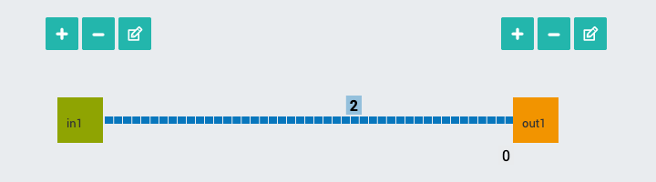 | 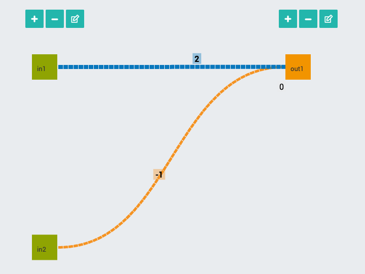 |

With the light sensor as input and the motor as output, the robot drives slower on darker surfaces. A hidden ReLU layer then turns the network into a line follower with an obstacle brake. Two changed weights make the brake stop the robot completely: `out_r = relu(30 + 13.04 − 2 · 50.95) = 0`.

| Speed follows light | Hand-set 2-3-2 network |
|---|---|
| 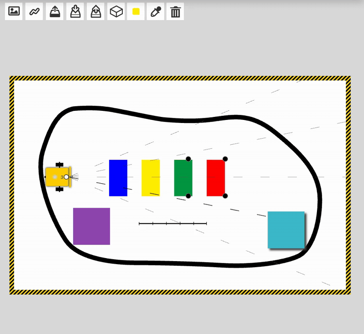 | 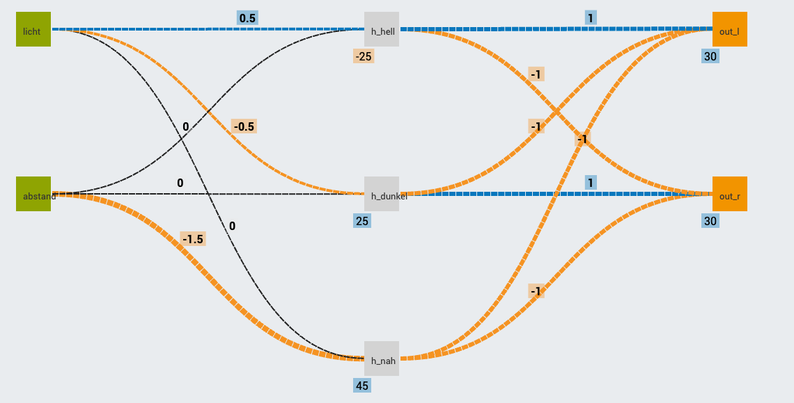 |

[Read more →](open-roberta-xnn)

## 2. Iris in nn-visual: watching weights move

A 4-4-4-3 network with 55 parameters. The learning rate decides almost everything: 0.02 / 0.10 / 0.50 give a test accuracy of 82.2 / 86.7 / 97.8 % after 100 epochs.

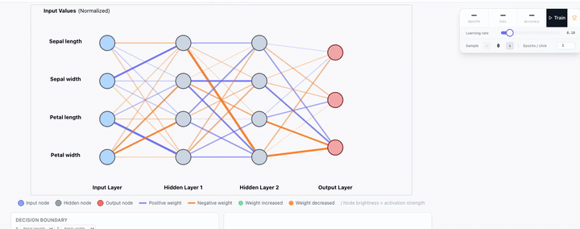

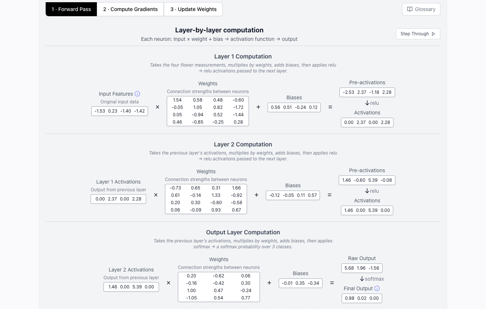

[Read more →](iris-nn-visual)

## 3. NIM with a matchbox learner

Three boxes with coloured chips learn to win NIM. A win adds a chip of the drawn colour, a loss removes it. Against an optimal opponent the computer wins 15 of the first 20 games and 20 of the last 20.

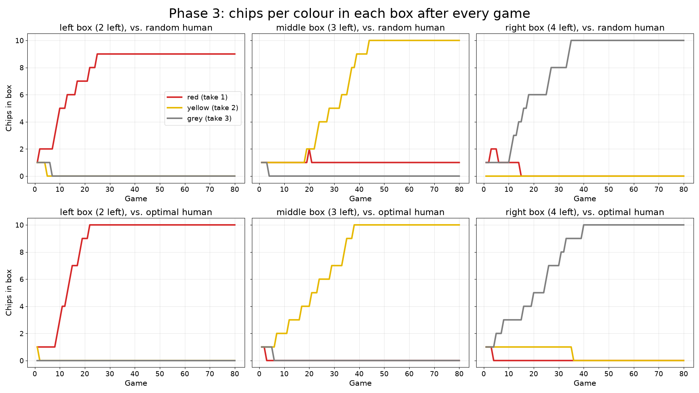

[Read more →](nim-menace) · `python3 -m pytest` runs the tests.

## 4. CartPole with a Deep Q-Network

Three own DQN runs reach a mean evaluation return of 33.4, 64.4 and 80.4. The pretrained model of the page holds the pole for all 500 steps in 5 of 5 episodes.

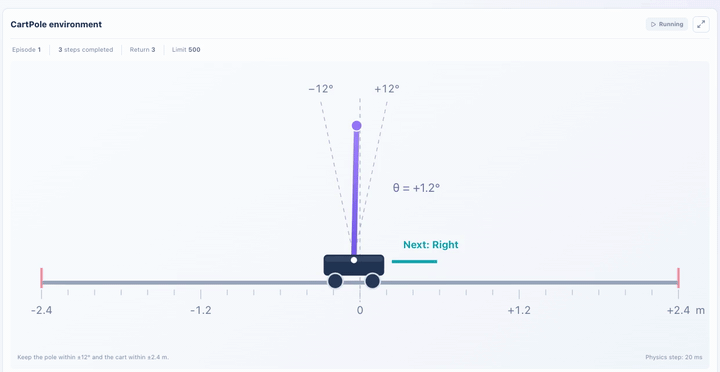

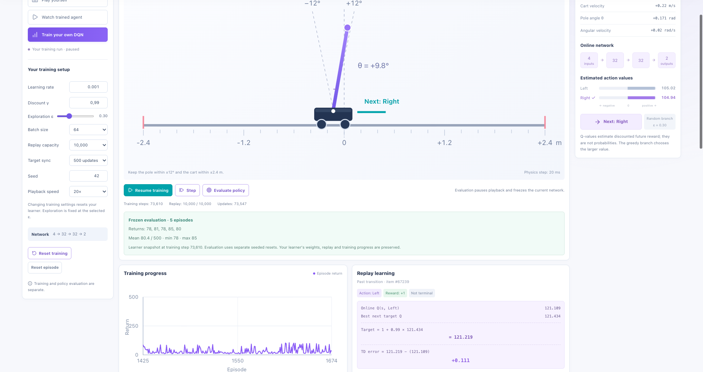

[Read more →](cartpole-rl)

## Repository layout

```text
open-roberta-xnn/   NEPO programs (XML), training data, screenshots
iris-nn-visual/     screenshots and animations of training runs
nim-menace/         nim_game.py, tests, results.csv, plots
cartpole-rl/        screenshots and animations of DQN runs
assets/             hero animation
```

## License

[MIT](LICENSE) © 2026 Rustam Kohen. Screenshots show the public tools linked above.
