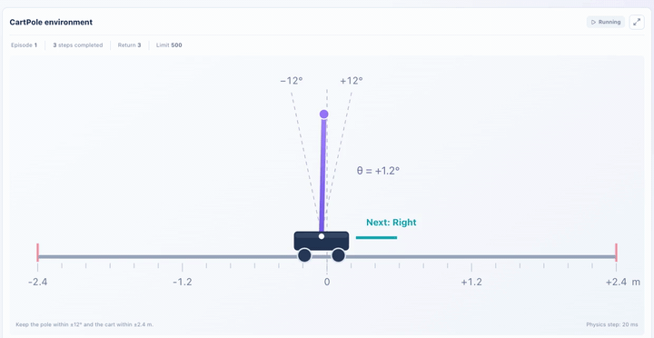
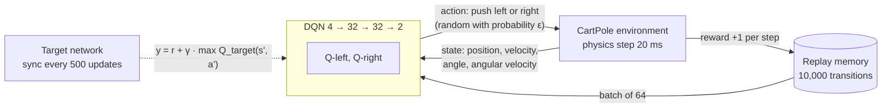
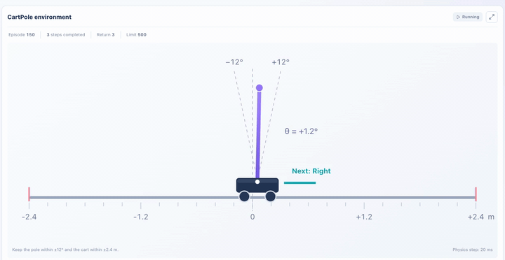
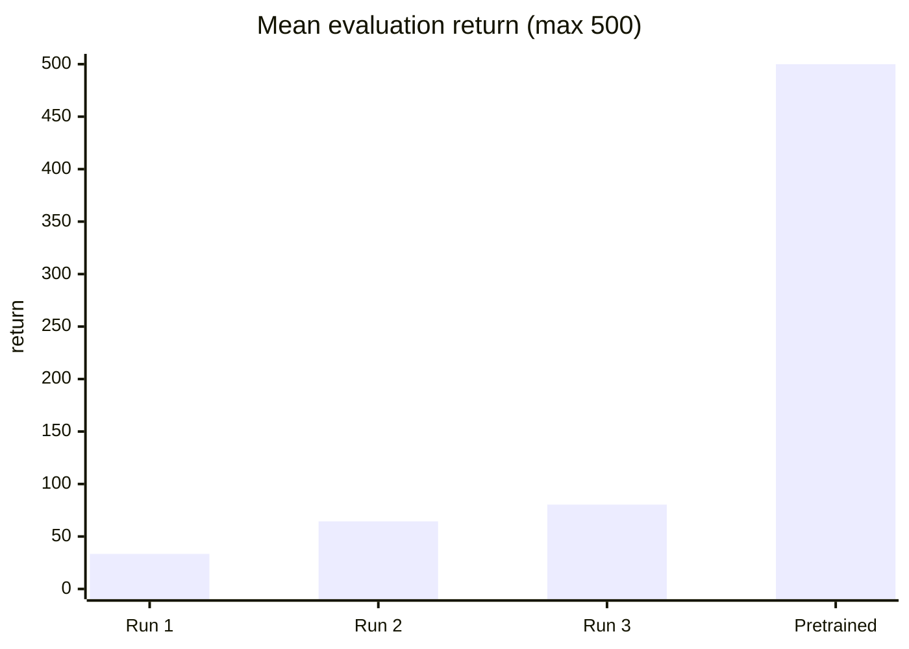
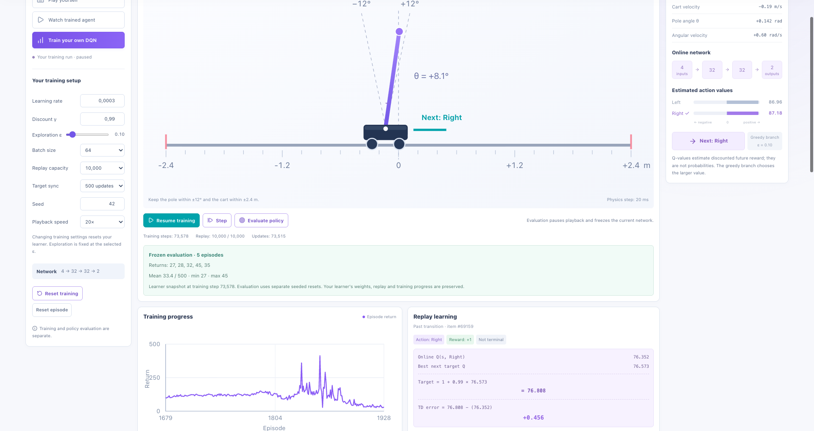
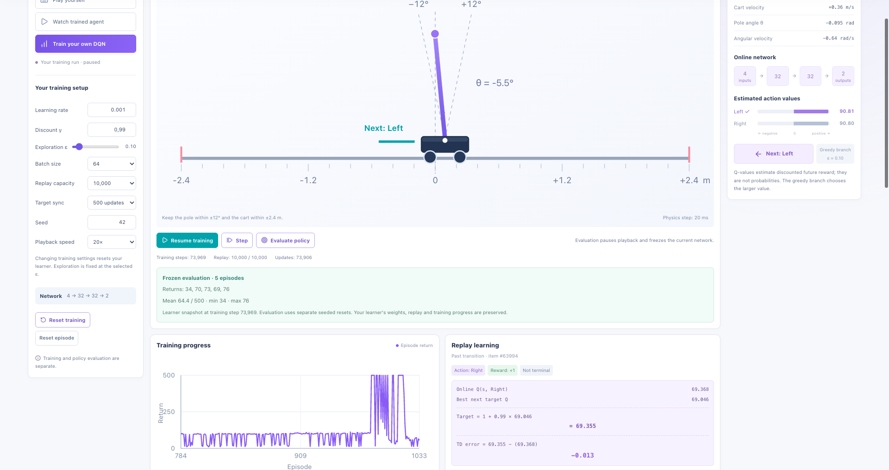
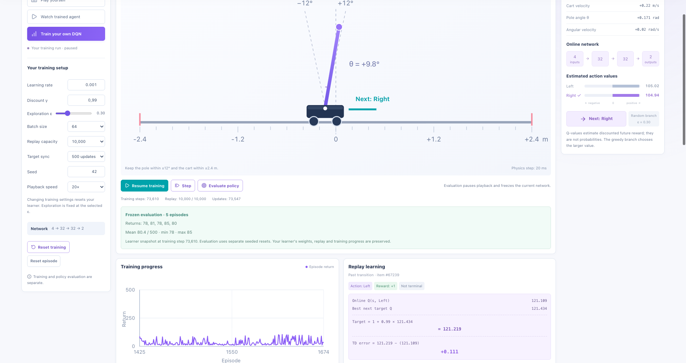
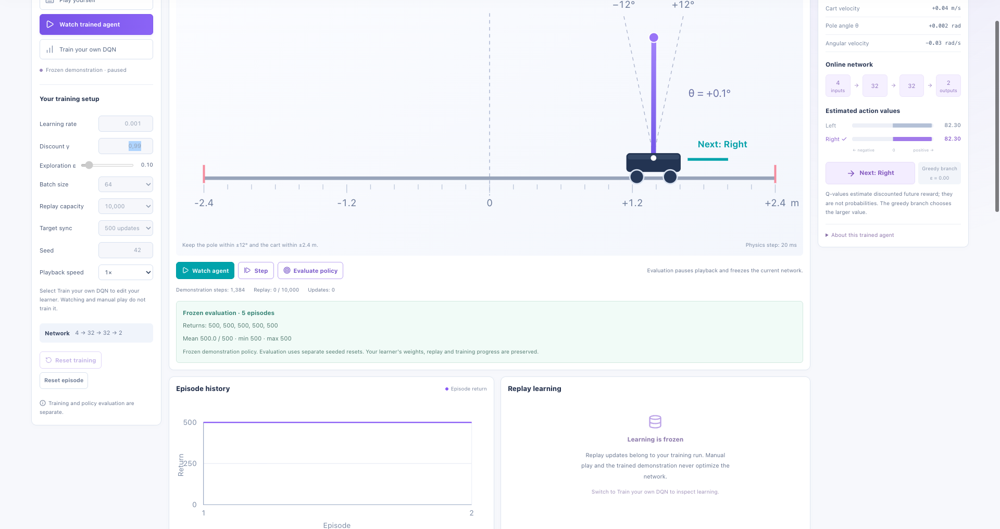

# CartPole with a Deep Q-Network

A DQN learns to balance a pole on a cart in the browser playground of [ML HIVE](https://mlhive.com/playground/machine-learning/reinforcement-learning). Three own training runs are compared with the pretrained model of the page. All numbers are read from the page.

## The setup

- **State:** cart position, cart velocity, pole angle, angular velocity.
- **Action:** a fixed push to the left or to the right.
- **Reward:** +1 per step. An episode ends at more than ±12° tilt or ±2.4 m displacement, at the latest after 500 steps.
- **ε:** with probability ε the network picks a random action (explore), otherwise the action with the larger Q-value (exploit).
- **γ = 0.99:** a reward 100 steps ahead still counts about 37 %.

Shared settings: γ 0.99, batch 64, replay capacity 10,000, target sync every 500 updates, seed 42, playback 20×. Each run trained about 73,600 steps and was then frozen and evaluated over 5 episodes.

## Results

| Run | Learning rate | ε | Training steps | Evaluation returns | Mean / min / max |
|---|---|---|---|---|---|
| 1 | 0.0003 | 0.10 | 73,578 | 27, 28, 32, 45, 35 | 33.4 / 27 / 45 |
| 2 | 0.001 | 0.10 | 73,969 | 34, 70, 73, 69, 76 | 64.4 / 34 / 76 |
| 3 | 0.001 | 0.30 | 73,610 | 78, 81, 78, 85, 80 | 80.4 / 78 / 85 |
| Pretrained | fixed | fixed | 1,384 demo steps | 500, 500, 500, 500, 500 | 500.0 / 500 / 500 |

| Run 1: lr 0.0003, ε 0.10 | Run 2: lr 0.001, ε 0.10 |
|---|---|
|  |  |

| Run 3: lr 0.001, ε 0.30 | Pretrained model |
|---|---|
|  |  |

## What the runs show

- The higher learning rate gave longer episodes for the same number of steps and a higher evaluation mean.
- In the curve of run 2 single episodes reached 500, then the return dropped again. DQN training is unstable.
- All runs are single runs with one seed and far from the pretrained model.
