# Iris classifier in nn-visual: watching weights move

A 4-4-4-3 network learns the Iris dataset in the browser app [Neural Network Visual](https://www.nn-visual.com/). The app shows every weight as a line, every bias in a matrix view, and every training step as forward pass, gradients and update. All numbers below are read from the app.

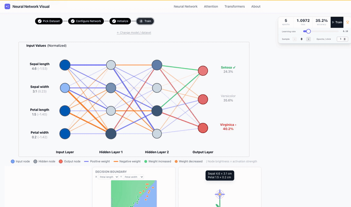

## The network

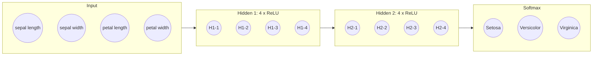

- 150 samples, 4 inputs in cm, 3 classes, cross-entropy loss.
- 55 trainable parameters: (4·4 + 4) + (4·4 + 4) + (4·3 + 3).
- The app normalises the inputs before training (for example 4.6 cm becomes −1.53).
- Weights start as small random values, all biases start at 0.000. Before training the network guesses, the app names about 33 % accuracy as chance level.

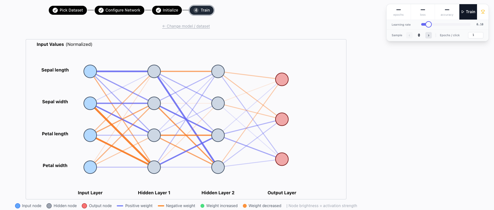

## One learning step, three views

**1 · Forward pass.** Input times weights plus bias, then ReLU, at the end softmax.

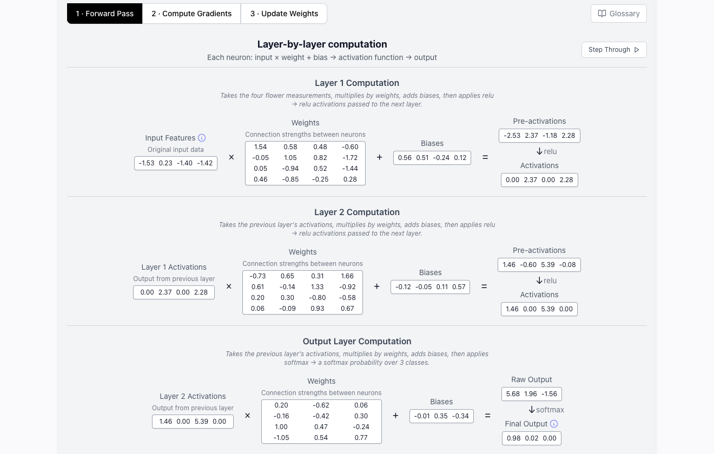

**2 · Compute gradients.** Error = prediction minus actual, then back through the layers with the chain rule.

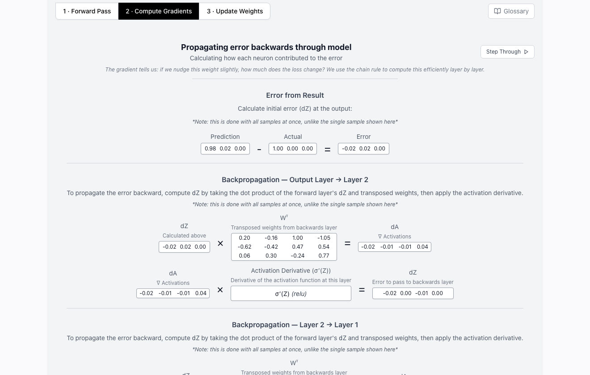

**3 · Update weights.** Each weight moves a small step against its gradient. The step size is the learning rate η.

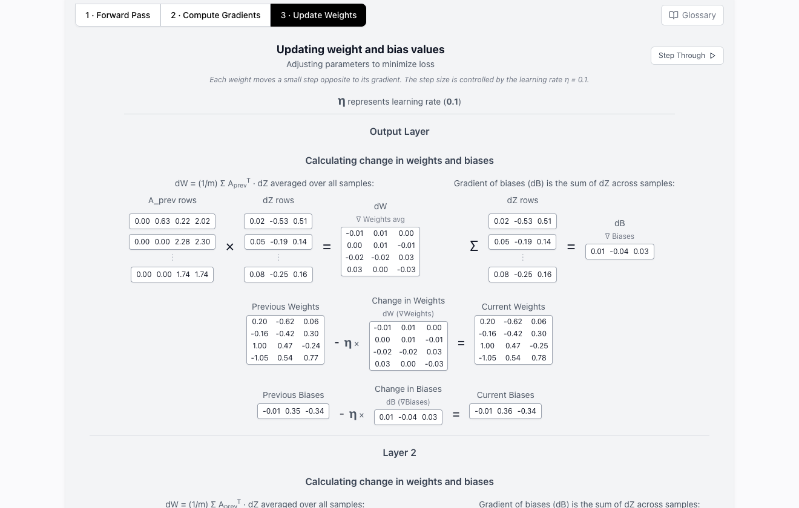

## Three learning rates

All runs: Iris, 4 → 4 → 4 → 3, ReLU, softmax, cross-entropy, 100 epochs (5 per click), new random initialisation per run.

| Run | Learning rate | Train loss | Test loss | Train accuracy | Test accuracy |
|---|---|---|---|---|---|
| 3 | 0.02 | 0.9750 | 0.9844 | 74.3 % | 82.2 % |
| 1 | 0.10 | 0.3451 | 0.3639 | 85.7 % | 86.7 % |
| 2 | 0.50 | 0.0878 | 0.0501 | 96.2 % | 97.8 % |

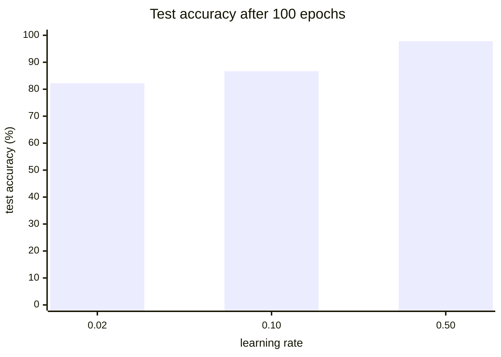

Intermediate values (train): run 1 epoch 5 loss 1.0972 / 35.2 %, epoch 30 loss 0.6939 / 78.1 %, epoch 60 loss 0.4368 / 80.0 %. Run 2 epoch 5 loss 0.5702 / 81.0 %, epoch 45 loss 0.1605 / 96.2 %.

| η = 0.02 | η = 0.10 | η = 0.50 |
|---|---|---|
| 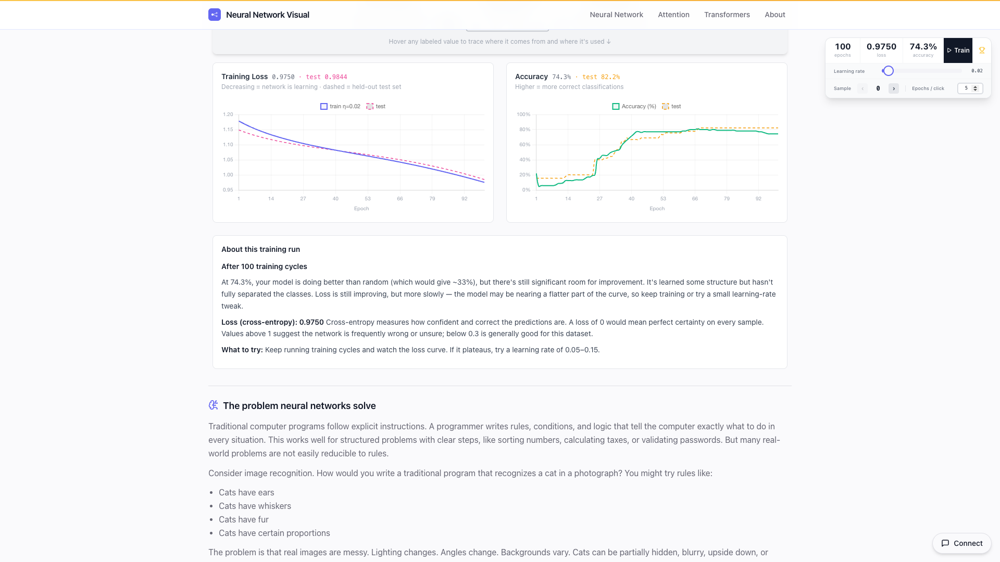 | 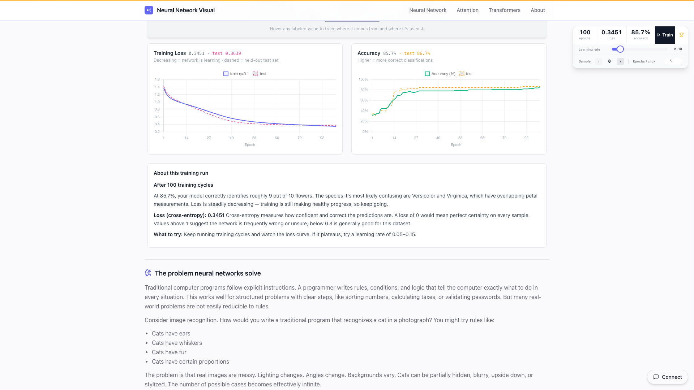 | 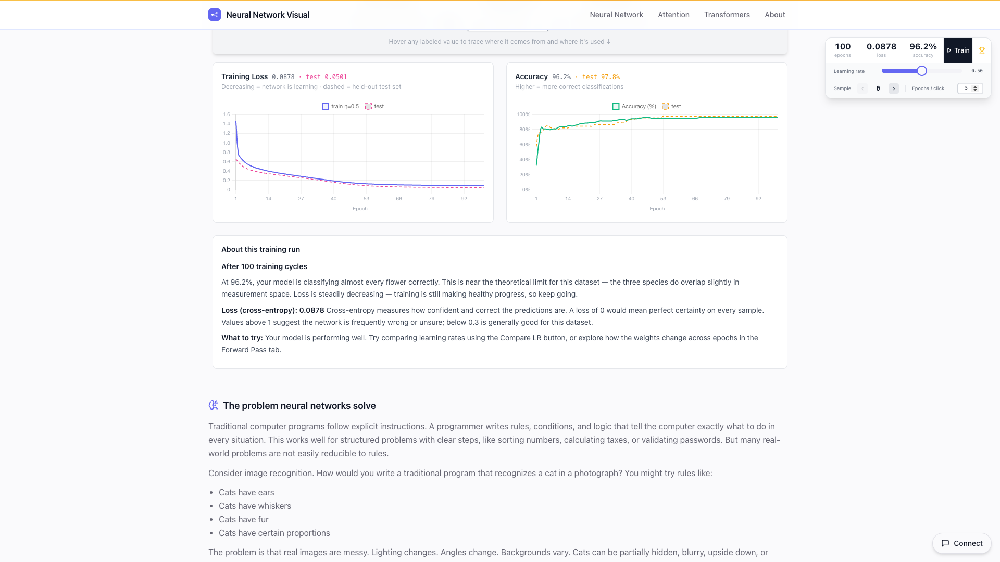 |

Train and test curves stay close in every run, so no overfitting is visible. The decision boundary (petal length against petal width) separates Setosa clearly. Versicolor and Virginica overlap, and the app names them as the most frequent confusion.

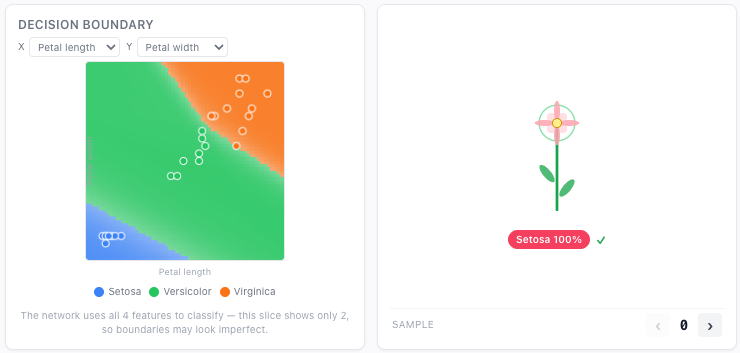

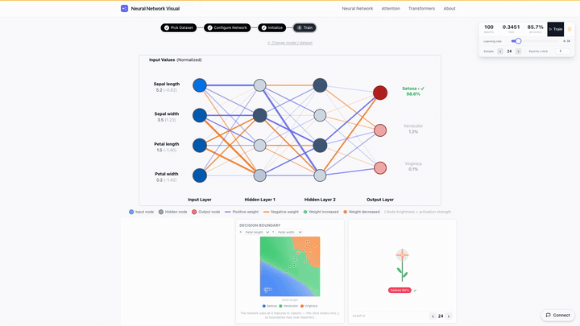

## Weights and biases over the epochs

Two extra runs with the same setting (learning rate 0.10, training to epoch 84) track one neuron: hidden layer 1, neuron 1 (H1-1).

**Run A**

| Epoch | Sepal length → H1-1 | Sepal width → H1-1 | Petal length → H1-1 | Petal width → H1-1 | Bias H1-1 | Train loss | Train accuracy |
|---|---|---|---|---|---|---|---|
| 0 | −0.4581 | 1.1206 | −0.2620 | −0.3518 | 0.000 | – | – |
| 1 | −0.4491 | 1.1160 | −0.2527 | −0.3423 | −0.008 | 1.5172 | 35.2 % |
| 5 | −0.4374 | 1.1083 | −0.2434 | −0.3333 | −0.025 | 1.1126 | 33.3 % |
| 20 | −0.4634 | 1.1363 | −0.2899 | −0.3800 | −0.019 | 0.7748 | 66.7 % |
| 50 | −0.4805 | 1.1760 | −0.3565 | −0.4505 | −0.025 | 0.5631 | 78.1 % |
| 84 | −0.5093 | 1.1670 | −0.4034 | −0.5015 | −0.053 | 0.4469 | 81.0 % |

| Epoch 0 | Epoch 84 |
|---|---|
| 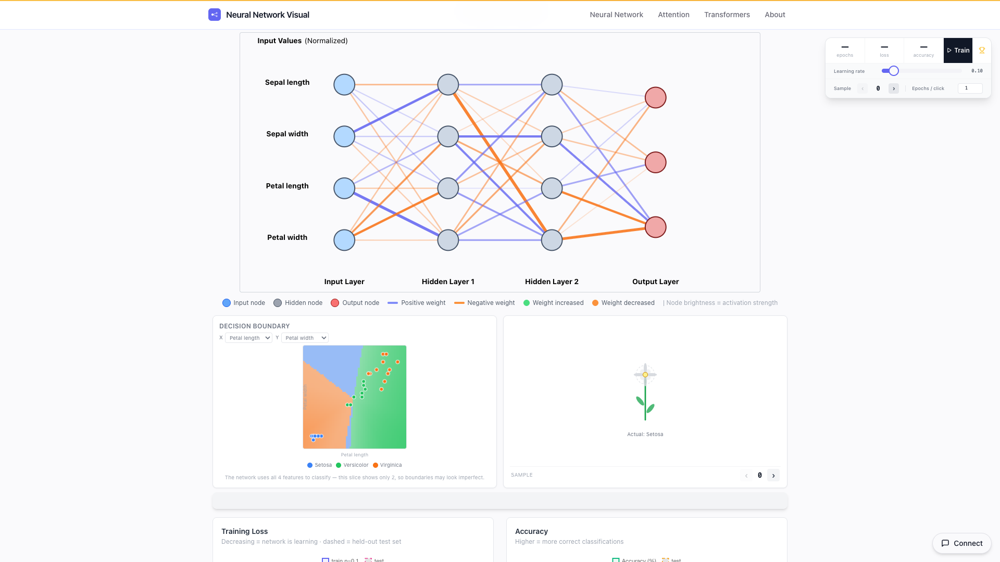 | 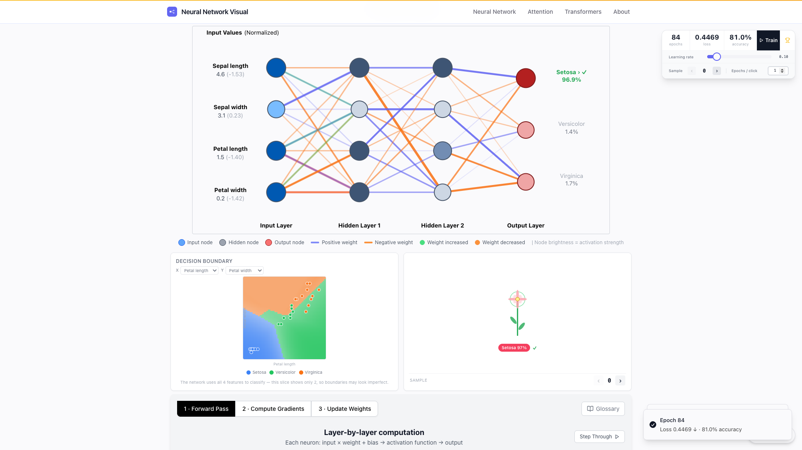 |

The forward-pass view at epoch 84 shows the same values rounded in the first column of the layer-1 weight matrix (−0.51 / 1.17 / −0.40 / −0.50).

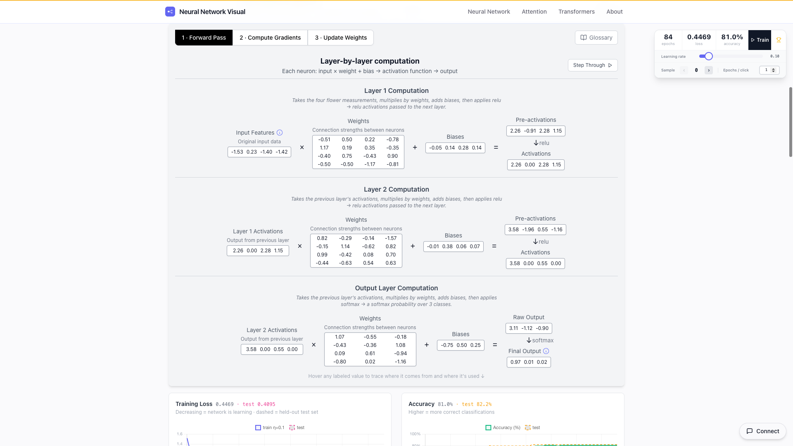

The first 30 epochs change lines and decision boundary the most:

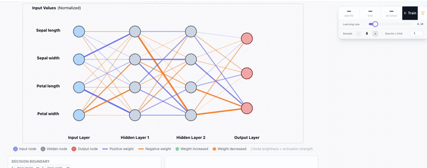

**Run A against run B (same setting, new initialisation)**

| | Run A | Run B |
|---|---|---|
| Sepal length → H1-1, epoch 0 / 84 | −0.4581 / −0.5093 | 0.7764 / 0.8135 |
| Sepal width → H1-1, epoch 0 / 84 | 1.1206 / 1.1670 | 0.1046 / 0.0329 |
| Petal length → H1-1, epoch 0 / 84 | −0.2620 / −0.4034 | 0.3892 / 0.4252 |
| Petal width → H1-1, epoch 0 / 84 | −0.3518 / −0.5015 | 0.0803 / 0.1181 |
| Bias H1-1, epoch 0 / 84 | 0.000 / −0.053 | 0.000 / 0.118 |
| Loss epoch 84, train / test | 0.4469 / 0.4095 | 0.4578 / 0.4293 |
| Accuracy epoch 84, train / test | 81.0 % / 82.2 % | 81.0 % / 86.7 % |
| Largest change of one weight (0 → 84) | 0.948 (H2-1 → Setosa: 0.1198 → 1.0674) | 0.694 (H2-3 → Virginica: 0.1091 → −0.5853) |
| Mean change over all 44 weights | 0.170 | 0.196 |

Same setting, but the same weight starts at −0.46 in one run and at +0.78 in the other. Training moves the weights only in small steps, so each run stays near its own start point and finds a different solution. Both reach 81.0 % train accuracy, with different weights and a different test accuracy.
