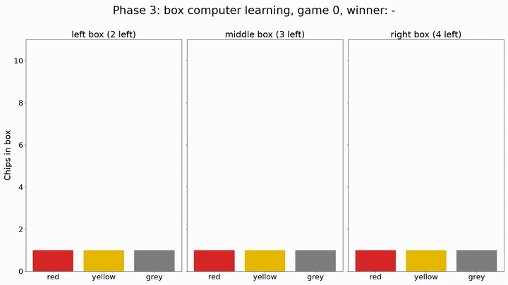
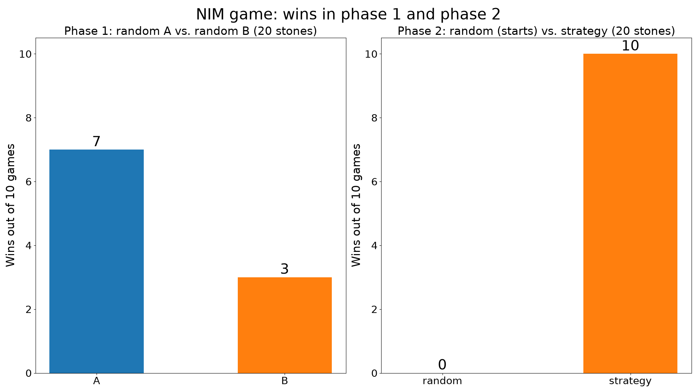
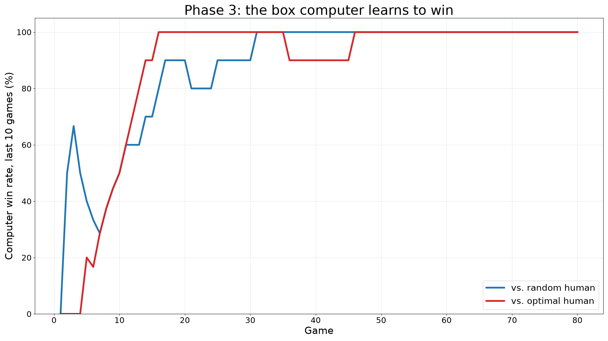
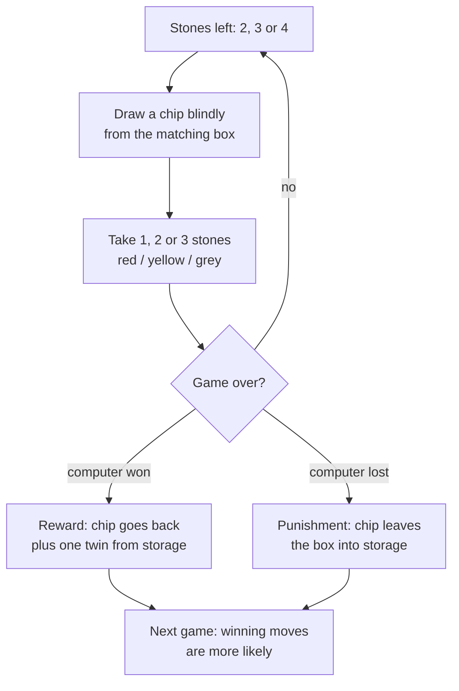
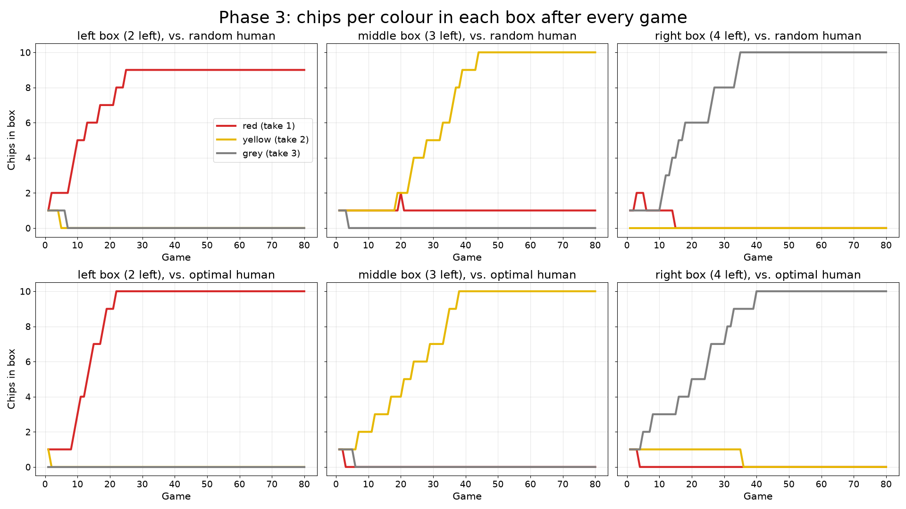

# NIM with a matchbox learner (MENACE style)

A Python simulation of the misère NIM game: players take 1, 2 or 3 stones in turn, and whoever takes the last stone loses. In phase 3 a "computer" made of three boxes with coloured chips learns the winning strategy by reward and punishment, with no strategy programmed in.



This is a digital version of a classroom game. The human players are simulated (a random player and an optimal player). The seed is fixed (`SEED = 2026`), so every run gives the same results.

## Run it

```bash
python3 -m pytest          # game logic and box update rule, no extra packages
python3 nim_game.py        # full simulation, needs matplotlib and ffmpeg
```

`nim_game.py` writes `results.csv`, the three plots in `images/` and the animation `phase3_learning.mp4`.

## The three phases

**Phase 1** (20 stones, two random players, 10 games): player A wins 7, player B 3. Without a strategy, chance decides.

**Phase 2** (20 stones, the random player always starts, 10 games): the strategy player wins 10 of 10.



**Phase 3** (5 stones, the human starts, the box computer learns, 80 games per opponent):

| Opponent | Computer wins total | First 20 games | Last 20 games |
|---|---|---|---|
| random human | 73 of 80 | 14 of 20 | 20 of 20 |
| optimal human | 74 of 80 | 15 of 20 | 20 of 20 |



## How the box computer learns

There is one box for 2, 3 and 4 stones left. Each box starts with one red, one yellow and one grey chip. The rest of the chips (10 per colour in total) lies in storage. Red means take 1, yellow take 2, grey take 3.



Final state against the optimal human: left box (2 left) 10 red, middle box (3 left) 10 yellow, right box (4 left) 10 grey. Every other colour is gone. The computer always leaves exactly one stone. Against the random human one red chip stays in the middle box, because a random opponent does not always punish this mistake.



## The winning strategy

Leave the opponent 1, 5, 9, 13 or 17 stones, so a count with remainder 1 when divided by 4. If the opponent takes 1, 2 or 3, take enough to make 4 together. At the end the opponent must take the last stone. With 20 stones the starting player wins by taking 3.

## Why this is a neural network idea

This is **reinforcement learning**. A win is the reward: the drawn chip gets a twin. A loss is the punishment: the chip leaves the box. The number of chips per colour acts like a **weight in a neural network**: it sets how likely a decision is and changes after every result. After about 40 games the weights have shifted so far that the computer cannot be beaten. The model is **MENACE** by Donald Michie (1961), a matchbox machine that learned tic-tac-toe the same way.

## Assumptions

- The rules do not say what a grey chip means with 2 stones left. Assumption: the computer takes all stones and loses.
- If the computer moves twice in one game, both chips are rewarded or punished, as in MENACE.
- Ten games in phase 1 and 2 are a small sample.
