# Open Roberta xNN: tiny networks that drive a robot

All programs run in the browser simulation of the [Open Roberta Lab](https://lab.open-roberta.org/) with the robot "Open Roberta xNN". No account is needed. Each program is exported as NEPO XML in [`programs/`](programs) and loads again via **edit → import program**. The network (names, shape, weights, biases) is stored inside the start block of the XML.

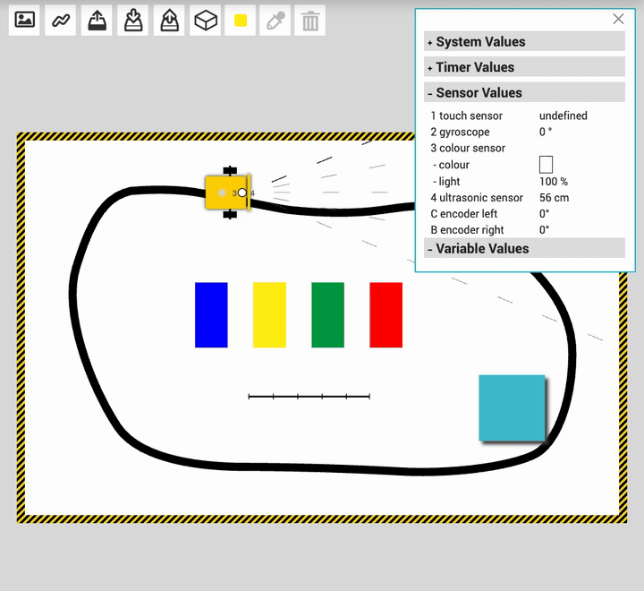

## Contents

1. [One weight, one output](#1-one-weight-one-output)
2. [Light sensor as input neuron](#2-light-sensor-as-input-neuron)
3. [Own example: line follower with an obstacle brake](#3-own-example-line-follower-with-an-obstacle-brake)
4. [v2a: a brake that really stops](#4-v2a-a-brake-that-really-stops)
5. [v2b: the same network, trained instead of hand-weighted](#5-v2b-the-same-network-trained-instead-of-hand-weighted)
6. [v2c: trained, and it stops](#6-v2c-trained-and-it-stops)
7. [Programs](#programs)

## 1. One weight, one output

**Example 1.** One input neuron `in1`, one output neuron `out1`, edge weight 2. The program sets `in1 = 1`, makes one NN step and stores `out1` in the variable `output`.

```text
out1 = 2 * in1 = 2 * 1 = 2
```

| Network | Simulation |
|---|---|
| 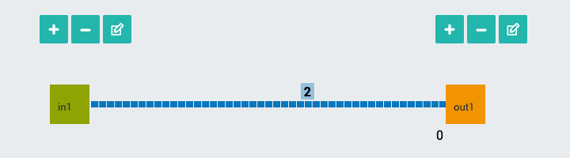 | 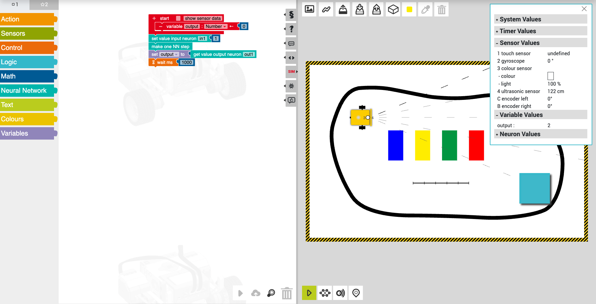 |

**Example 2.** A second input `in2 = 1` with weight -1. The lab shows the computation of `out1` when you click the neuron.

```text
out1 = 2 * in1 - 1 * in2 = 2 * 1 + (-1) * 1 = 1
```

| Network | Simulation |
|---|---|
| 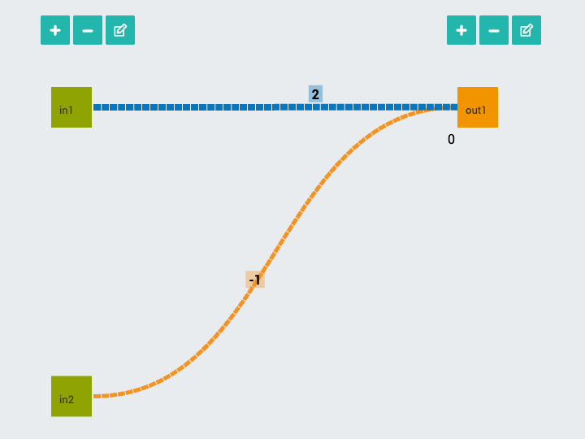 | 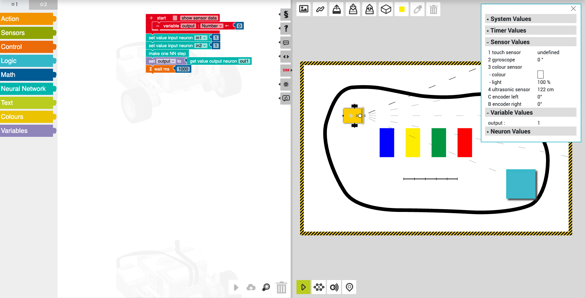 |

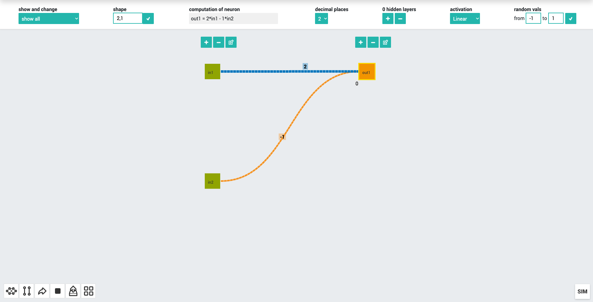

## 2. Light sensor as input neuron

The colour sensor on port 3 writes its light value (0 = black, 100 = white) into `in1`. With weight 1 and bias 0 the network passes the value through: `out1 = in1`.

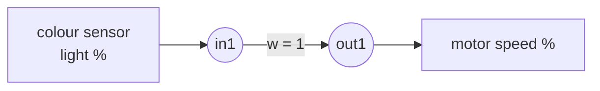

Measured light values in the simulator:

| Surface | in1 | out1 |
|---|---|---|
| White | 100 | 100 |
| Blue | 33.33 | 33.33 |
| Yellow | 64.31 | 64.31 |
| Green | 27.97 | 27.97 |
| Red | 33.33 | 33.33 |
| Black (own area) | 0 | 0 |

**Without a loop** the robot moves from x = 150 to x = 152 and stops. The network runs once, the program ends and the motors stop. **With "repeat indefinitely"** the robot reads a new value in every pass and uses `out1` as speed. The darker the surface, the slower it drives:

| Surface | out1 = speed | Distance per sample |
|---|---|---|
| White | 100 % | 26 to 28 units |
| Blue | 33.33 % | 9 to 10 |
| Yellow | 64.31 % | 20 to 22 |
| Green | 27.97 % | 7 |

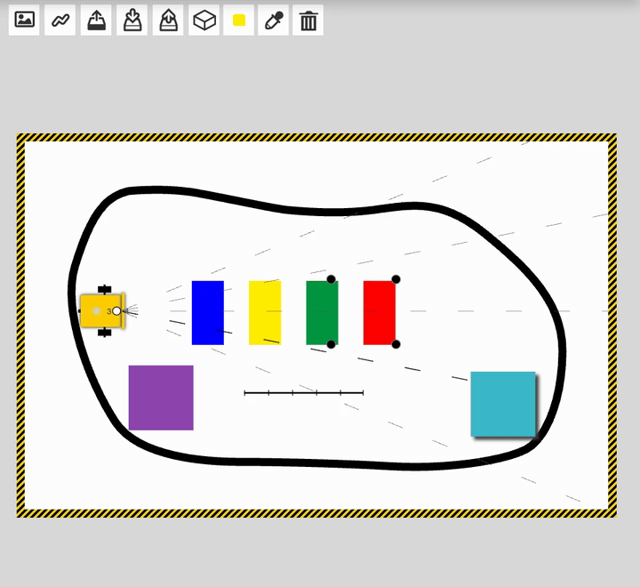

**Weight 0.5.** The robot drives half as fast everywhere: on white `out1 = 50` instead of 100, on blue `out1 = 16.67` instead of 33.33. On black it still stands, because 0.5 · 0 = 0.

**Two outputs, unequal weights.** `in1 → out_l` has weight 1, `in1 → out_r` has weight 0.5. On white the left wheel gets 100 and the right wheel 50, so the robot drives a right curve. On blue it gets 33.33 and 16.67. The ratio stays 2 : 1, so the curve radius stays the same, only the speed drops. The weights set the radius, the light value sets the speed.

| Curve on blue | Full run |
|---|---|
| 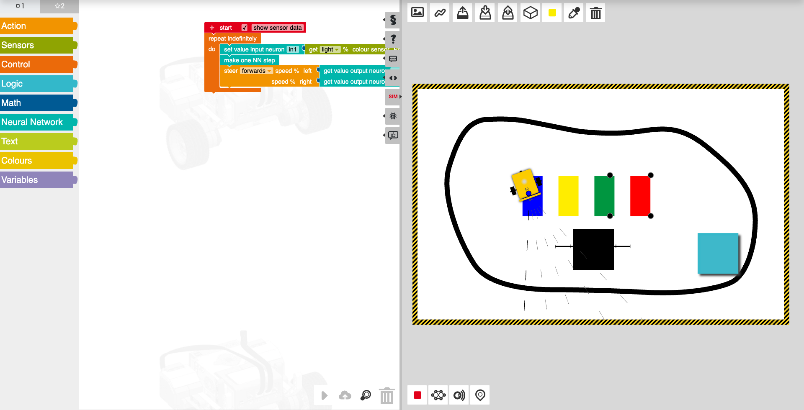 | 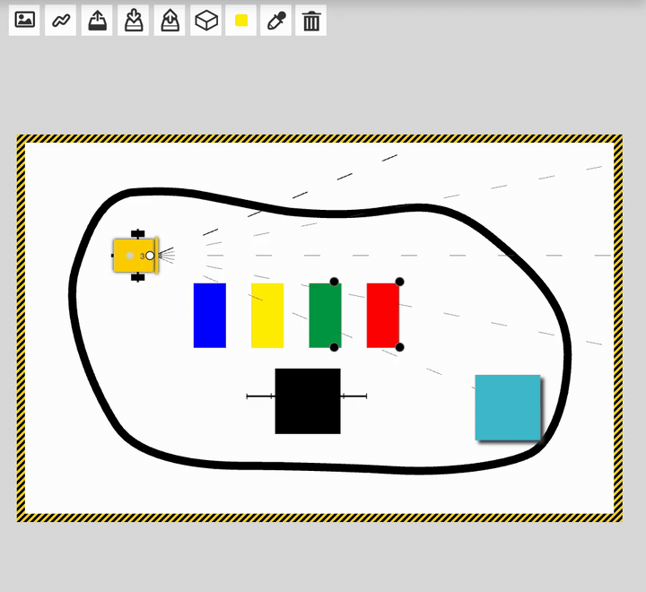 |

**Spiral background.** The same program (`in1` = light, one NN step, drive with speed `out1`, weight 1) runs on an own background image of the size of the default scene (730 × 460): an Archimedean spiral with a winding distance of 70 units. Inside each winding a grey gradient runs from white to black, followed by a hard edge back to white. The robot starts at x = 260, y = 230 facing left, so it crosses the windings outwards.

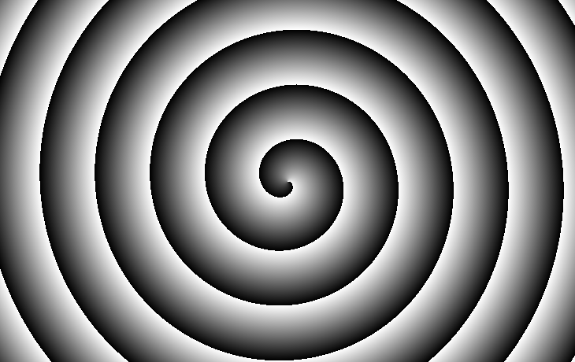

| Sample | Light | out1 | x |
|---|---|---|---|
| 1 | 28 % | 29.31 | 235.1 |
| 2 | 5 % | 4.98 | 218.6 |
| 3 | 36 % | 37.81 | 171.2 |
| 4 | 6 % | 6.31 | 149.7 |
| 5 | 51 % | 51.93 | 111.4 |
| 6 | 10 % | 10.47 | 82.8 |
| 7 | 90 % | 93.37 | 69.0 |

In every winding the robot slows down as the gradient gets darker before the black edge (5 %, 6 %, 10 %). Behind the edge the sensor sees bright again and the robot speeds up. It never stops completely, because the sensor never measures 0 exactly on the edge, so it creeps over the edge at a few percent. This is the behaviour of the colour areas above, with a smooth instead of a stepped surface.

| Start | Middle | End |
|---|---|---|
| 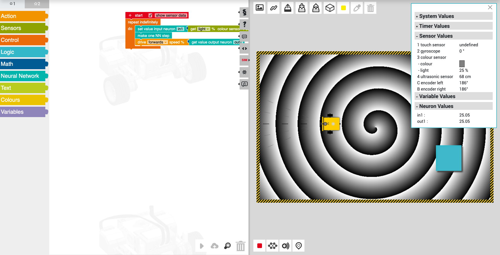 |  | 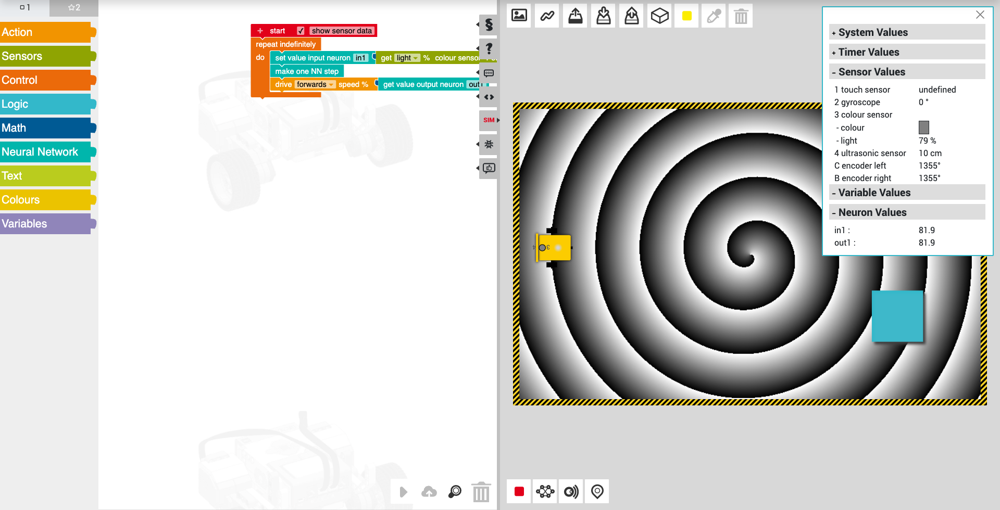 |

## 3. Own example: line follower with an obstacle brake

The robot follows the edge of the black line of the default scene. If the block is in front of it, the same network slows down. A purely linear network cannot treat "too bright", "too dark" and "obstacle near" as separate cases, so this network has a hidden layer with ReLU.

The screenshots show the identifiers used in the lab: `licht` = light, `abstand` = distance, `links` / `rechts` = left / right, `h_hell` = h_bright, `h_dunkel` = h_dark, `h_nah` = h_near. After the first simulation run the lab renames the hidden neurons internally to `h1n1`, `h1n2`, `h1n3` (in this order).

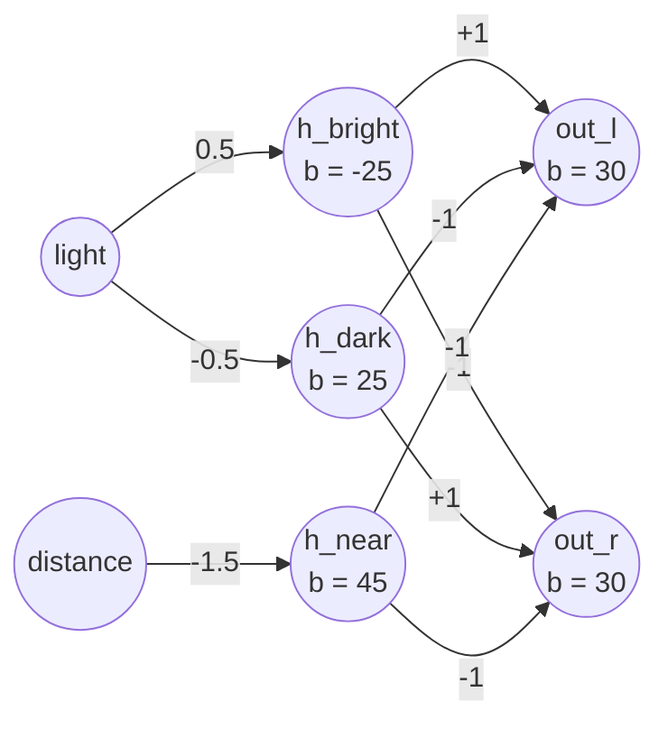

Shape 2,3,2, activation ReLU. All other edges have weight 0.

| Neuron | Computation | Meaning |
|---|---|---|
| h_bright | relu(0.5 · light − 25) | sensor sees more white than the edge (light > 50) |
| h_dark | relu(−0.5 · light + 25) | sensor sees more black than the edge (light < 50) |
| h_near | relu(−1.5 · distance + 45) | obstacle closer than 30 cm |
| out_l | relu(30 + h_bright − h_dark − h_near) | left motor |
| out_r | relu(30 − h_bright + h_dark − h_near) | right motor |

Why these weights:

- The edge between black and white gives about 50 %. Bias ±25 with weight ±0.5 puts the switching point of both light neurons exactly at light = 50.
- ReLU cuts negative values, so only one of the two light neurons is active at a time. The network behaves like a case distinction.
- On white (light = 100): h_bright = 25, out_l = 55, out_r = 5. The robot steers right towards the line. On black (light = 0) it is the other way round. On the edge both motors run at 30 %.
- h_near starts below 30 cm (−1.5 · 30 + 45 = 0) and subtracts the same amount from both motors.
- Bias 30 at the outputs is the base speed. ReLU at the output prevents negative motor values.

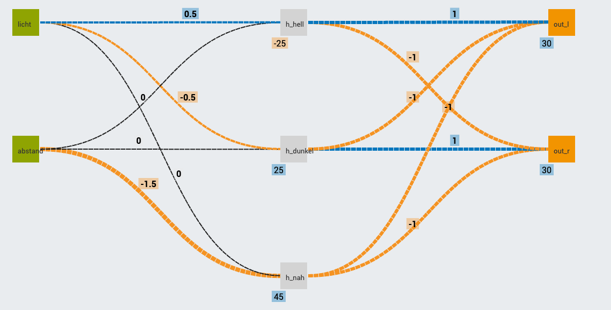

**Check at the obstacle** (values from the neuron view of the lab):

```text
light    = 23.92  ->  h_dark = -0.5 * 23.92 + 25 = 13.04
distance = 12.7   ->  h_near = -1.5 * 12.7  + 45 = 25.95
out_r    = 30 + 13.04 - 25.95 = 17.09
```

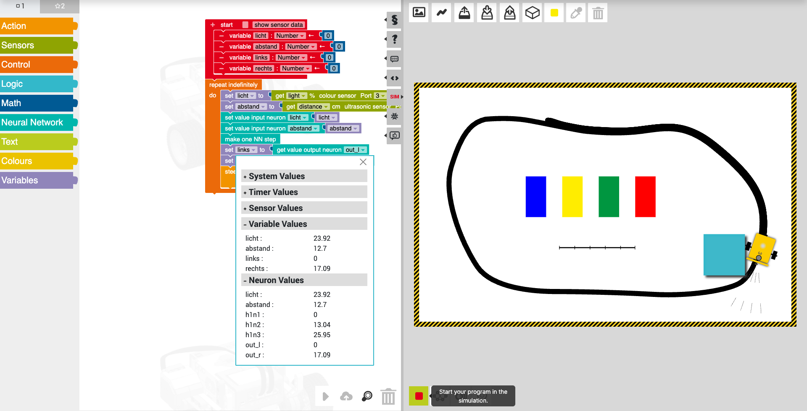

**Weak point:** the brake does not stop completely. The right motor keeps 14 to 17 %. The robot only stands because it touches the block.

## 4. v2a: a brake that really stops

Only two places in the network change:

| Value | v1 | v2a |
|---|---|---|
| Weight distance → h_near | −1.5 | −3 |
| Bias h_near | 45 | 90 |
| Weight h_near → out_l and h_near → out_r | −1 | −2 |

h_near = relu(−3 · distance + 90) still starts at 30 cm but rises twice as fast, and it pulls twice as hard on the motors. Above 30 cm nothing changes, so line following stays the same.

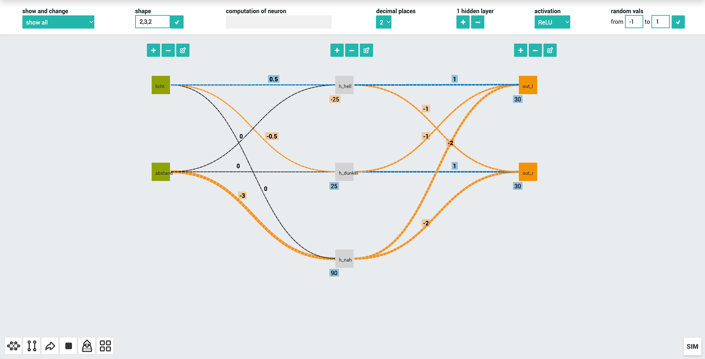

| Value at the block | v1 | v2a |
|---|---|---|
| light | 23.92 | 23.92 |
| distance | 12.7 cm | 13.02 cm |
| h_dark (h1n2) | 13.04 | 13.04 |
| h_near (h1n3) | 25.95 | 50.95 |
| out_l | 0 | 0 |
| out_r | 17.09 | 0 |

```text
out_r = relu(30 + 13.04 - 2 * 50.95) = relu(-58.86) = 0
```

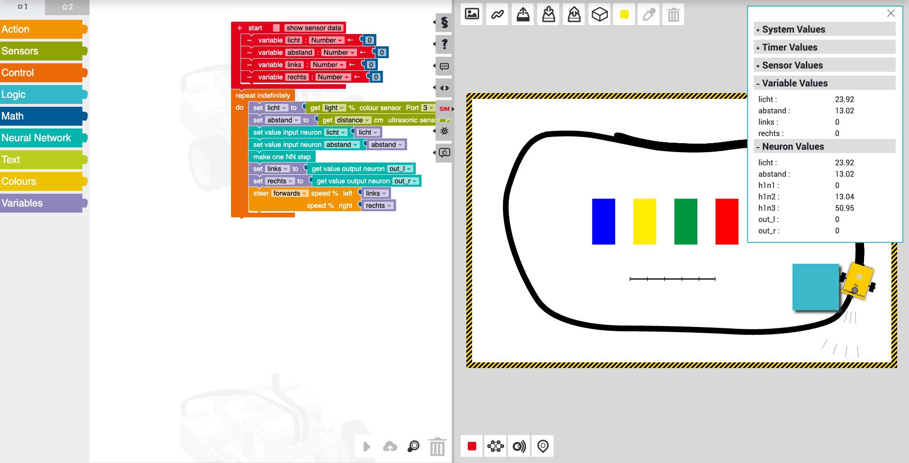

## 5. v2b: the same network, trained instead of hand-weighted

The tab **NEURAL NETWORK Learn** trains the network from a table. The training data are 63 examples (light 0 to 100 in 9 steps times distance 10 to 100 cm in 7 steps). The targets come from the v2a network function ([`data/`](data)).

- **First try, raw values:** learning rate 0.0001, 3000 epochs, loss 19,283 → 19,253. Practically no learning.
- **Normalised (all values / 100), random start weights −0.5 to 0.5, learning rate 0.03:** loss 2.676 → 2.670 after 3000 epochs. Most start weights were negative, so the ReLU neurons stayed at 0 and got no gradient ("dead" neurons). This is a guess from the start weights.
- **Normalised, random start weights 0 to 0.5, learning rate 0.01:** the loss falls by more than half.

| Epoch | 486 | 1469 | 2938 | 4591 | 7272 | 9000 |
|---|---|---|---|---|---|---|
| Loss | 1.758 | 1.496 | 1.220 | 1.017 | 0.882 | 0.853 |

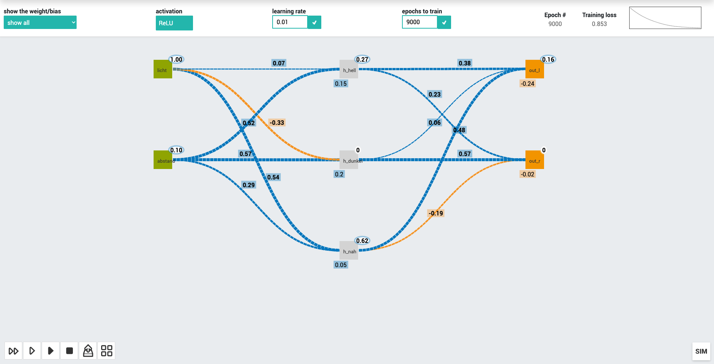

What the network learned: h_dark drives almost only the right motor (0.06 to 0.57), so "on black, steer left" like v2a. All neurons depend positively on distance, so "far away = faster". A real brake neuron like h_near in v2a did not appear.

**Driving behaviour:** the robot follows the line and slows down with decreasing distance (69.8 cm: left 29.2 / right 20.8 %, 35.8 cm: 13.4 / 10.6 %, 25.7 cm: 8.7 / 7.6 %). It does not stop. One reason is the small number of examples below 20 cm (3 of 7 distance steps) against a remaining loss of 0.85.

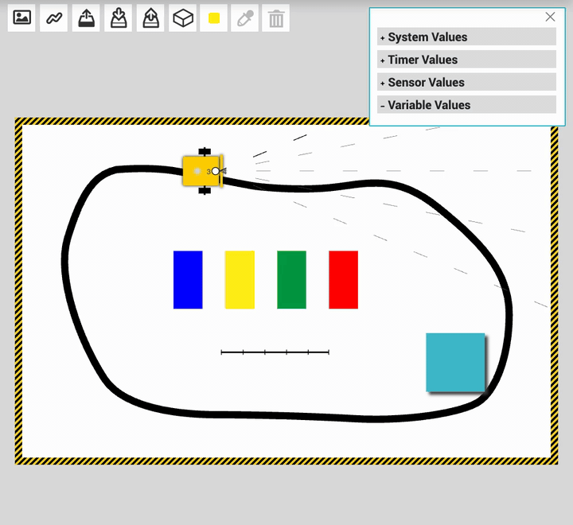

## 6. v2c: trained, and it stops

Goal: the trained network should stop completely at the block, like v2a. Program, shape 2,3,2, ReLU and start position are the same as in v2b.

**New training data:** 117 examples ([`data/v2c_training_data_normalized.csv`](data/v2c_training_data_normalized.csv)). Light uses the same 9 steps, distance now uses 13 steps (8, 10, 12, 14, 16, 18, 20, 22, 25, 30, 45, 60 and 100 cm). 7 of the 13 distance steps are at 20 cm or below, in v2b it was 3 of 7. The targets again come from the v2a network function, all values divided by 100. Below 21 cm the target for both motors is 0.

- **Try 1, continue training the v2b weights, learning rate 0.03:** loss 1.328 at epoch 1218, 1.322 at epoch 5000. No learning.
- **Try 2, random start weights 0 to 0.5, learning rate 0.3:**

| Epoch | 1813 | 3625 | 5000 | 6812 | 8623 | 10436 | 13933 | 15000 |
|---|---|---|---|---|---|---|---|---|
| Loss | 1.081 | 0.697 | 0.465 | 0.294 | 0.194 | 0.126 | 0.059 | 0.089 |

The differences to v2b: more near examples and a 30 times higher learning rate (0.3 instead of 0.01).

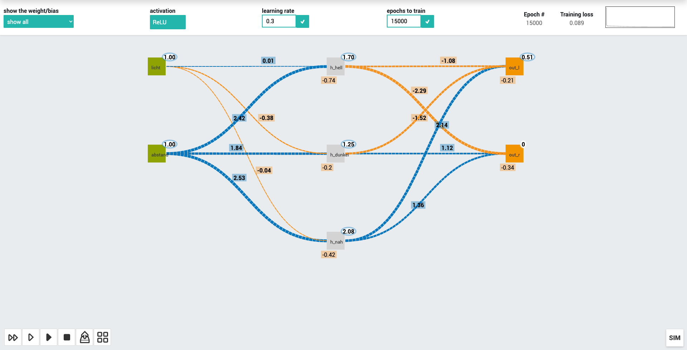

**Driving behaviour** (sensor window, about every 3 s):

| Time | distance | left | right |
|---|---|---|---|
| 6 s | 73.38 cm | 26.01 % | 26.19 % |
| 15 s | 31.55 cm | 27.38 % | 25.38 % |
| 18 s | 26.21 cm | 8.04 % | 11.64 % |
| 24 s | 40.05 cm | 26.21 % | 26.47 % |
| 27 s | 12.9 cm | 0 | 0 |
| 30 s | 12.9 cm | 0 | 0 |

In the curve the robot brakes briefly at 26 cm and drives on when the block leaves the ultrasonic cone again. At the block it measures 12.9 cm. All neurons are 0, out_l = out_r = 0, both motors stand. The encoders stay at 4328° and 3662° from 27 s to beyond 30 s, so the robot really stands. With more near examples and a higher learning rate the network learns the safe stop of v2a.

| Neurons at the block | Stopped at the block |
|---|---|
| 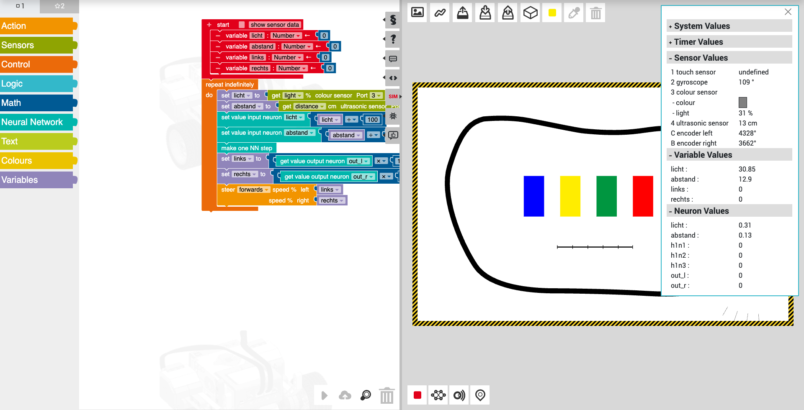 | 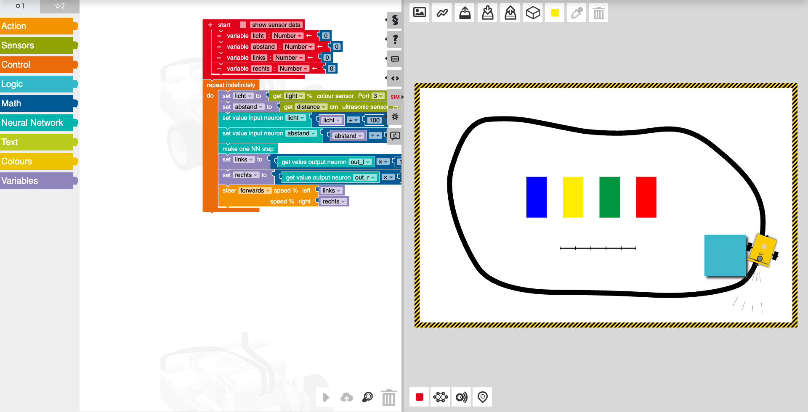 |

## Programs

| File | Content |
|---|---|
| `01_one_input_weight_2.xml` | Example 1 |
| `02_two_inputs_weight_minus_1.xml` | Example 2 |
| `card_s1_*`, `card_s2_*`, `card_s3_*` | Learning cards: hello world, square with and without loop, stop at touch, attraction with weight 1 and 0.5 |
| `light_1_read_value.xml`, `light_2_read_value_loop.xml` | Light value into the network |
| `light_3_drive_no_loop.xml`, `light_4_drive_loop.xml` | Speed from light, without and with loop |
| `light_5_weight_0.5.xml` | Same with weight 0.5 |
| `light_6_curve_weights_1_0.5.xml` | Two outputs, curve |
| `light_7_spiral.xml` | Speed from light on the spiral background |
| `line_follower_v1.xml`, `line_follower_v2a_braking.xml`, `line_follower_v2b_trained.xml`, `line_follower_v2c_trained_stop.xml` | Own example |
| `data/v2b_training_data_raw.csv`, `data/v2b_training_data_normalized.csv` | 63 training rows `light;distance;out_l;out_r` |
| `data/v2c_training_data_normalized.csv` | 117 training rows, all values divided by 100 |

## Limits

- v1 and v2a are hand-weighted. The values fit this scene and this start direction.
- With one light sensor the robot follows only one edge and only clockwise. It visibly oscillates in curves.
- v2b learns line following and slowing down, but not the safe stop of v2a. v2c learns the stop with more near examples and a higher learning rate.
